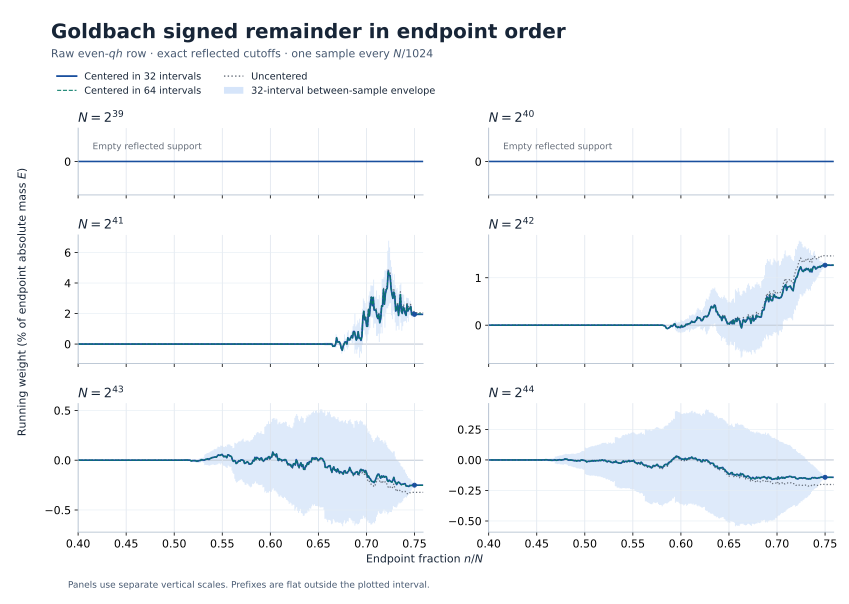

# Running centered sums in endpoint order

23 November 2026. Finite diagnostic on the raw even-\(qh\) signed semiprime remainder. Keep the reflected Type II weights and all arithmetic cutoffs from the previous endpoint run. The plotted quantity has a separate exact cofactor calculation for the centering correction. [Pinned signed endpoint factorization and finite support](https://github.com/Sodelin/Research-Commons/blob/2cc4b7f27c3e76988039815b950da2685d97e503/research/2026-11-23-goldbach-residue-obstruction/argument-catalog/2026-11-23-codex-signed-endpoint-balance-2336z/README.md)



## Finite result

In each row below the endpoint absolute mass is \(E=\sum_n|A_+^{\rm raw}(N-n)G_D(n)|\). The peak is the largest absolute centered value at a plotted point. The envelope is an upper bound from cell variation, evaluated with the numerical log weights, that also covers endpoints between plotted points. All weight columns are percentages of \(E\). The center is taken over 32 equal intervals unless marked 64.

| \(N\) | Uncentered final | Centered final | Sampled peak | All-endpoint envelope | Peak \(n/N\) | 64-interval peak | 64-interval envelope |
|:--|--:|--:|--:|--:|--:|--:|--:|
| \(2^{39}\) | empty | empty | empty | empty | — | empty | empty |
| \(2^{40}\) | empty | empty | empty | empty | — | empty | empty |
| \(2^{41}\) | +2.058% | +1.946% | 4.773% | 6.768% | .72266 | 4.782% | 6.648% |
| \(2^{42}\) | +1.461% | +1.265% | 1.269% | 1.781% | .74902 | 1.272% | 1.765% |
| \(2^{43}\) | −.324% | −.251% | .264% | .664% | .74414 | .266% | .678% |
| \(2^{44}\) | −.201% | −.142% | .159% | .544% | .69434 | .160% | .548% |

At \(2^{41}\) the centered curve falls from a \(4.77\%\,E\) positive peak to \(1.95\%\,E\). At \(2^{42},2^{43},2^{44}\) the terminal magnitude already accounts for about \(100\%,95\%,90\%\), respectively, of the largest sampled centered magnitude. The largest all-endpoint envelope is under \(6.8\%\,E\), and the other three are under \(1.8\%\,E\). These measurements favor checking shorter intervals first. They give no indication of a full-scale positive stretch later canceled by a full-scale negative stretch. Across grid-aligned windows of length \(N/64\), the largest absolute 32-interval-centered increments are \(2.80\%,0.51\%,0.14\%,0.10\%\) of \(E\) at the four nonempty targets. The two centering choices produce similar curves. The centering corrections still matter relative to the small signed totals.

The nonempty targets reproduce the raw endpoint counts \(727,\,22258,\,174569,\,990018\) and the earlier uncentered signed and absolute totals. All expanded endpoints here are three-prime products, with \(b=1\) and \(G_D=-\log n\). The data concern this finite reflected expression. Additional divisor placements and even expanded endpoint parity enter at other scales.

## Exact specification and between-sample check

Use \(F_+=1\), \(U=V=N^{1/40}\), \(P=N^{21/40}\), \(D=N^{799/1520}\), and the pinned \(Z_1\). Set
\[
 A(n)=A_+^{\rm raw}(N-n),\qquad
 G^\circ(n)=\mathbf1_{n\le N-q_{\min}(q_{\min}+2)}G_D(n),
\]
where \(q_{\min}\) is the first odd integer exceeding \(H/2\) and \(H=\sqrt N\). Beyond that maximum endpoint \(A(n)=0\), so truncating \(G_D\) there preserves the uncentered sum. It fixes the centering convention and makes the empty targets identically zero. For every centering interval \(I\) take
\[
 \overline G_I=\frac{1}{|I|}\sum_{n\in I}G^\circ(n),\qquad
 C(x)=\sum_{n\le x}A(n)\bigl(G^\circ(n)-\overline G_{I(n)}\bigr).
\]
The mean includes every integer in \(I\), with zero values included. In particular its numerator includes every admissible triple endpoint, whether or not its complementary \(m=N-n\) has a balanced squarefree factorization. Both partitions use \(N/B_0\) integers per interval, with \(B_0=32,64\), so both satisfy the previously justified scale \(N/(\log N)^2\). The plot samples \(x=jN/1024\). All gridded cells \(J=(x_{j-1},x_j]\) lie wholly within a centering interval. [Centering identity and masks](https://github.com/Sodelin/Research-Commons/blob/2cc4b7f27c3e76988039815b950da2685d97e503/research/2026-11-23-goldbach-residue-obstruction/argument-catalog/2026-11-23-codex-signed-endpoint-balance-2336z/README.md#a-signed-correlation-to-prove)

The triple scan supplies \(\sum_J A(n)G^\circ(n)\), \(\sum_J |A(n)G^\circ(n)|\), and \(\sum_JG^\circ(n)\). A separate cofactor calculation supplies \(\sum_J A(n)\). For each odd squarefree \(q\in(H/2,H]\), the product condition \(N-qh\in J\) is one interval for \(h\). On even \(qh\) the ordered sign weight on \(h\) is
\[
 \frac{\mu(h)+\mu(q)\mu(h)^2}{2}\log h,
\]
with \(h\) odd and \((h,q)=1\). Expand the last condition by \(\sum_{d\mid(q,h)}\mu(d)\) and use precomputed prefixes of \(\mu(h)\log h\) and \(\mu(h)^2\log h\) on odd multiples of each \(d\). The ordered absolute weight is \((\mu(h)^2+\mu(q)\mu(h))\log h/2\). The ordered sums have the same normalization as the paired expression. A direct ordered enumeration at \(N=2^{16}\) checked both cofactor formulas in all 1,024 cells. That small check is for the cofactor algorithm only.

For a cell \(J=(a,b]\), let
\[
 V_J=\sum_{n\in J}|A(n)G^\circ(n)|
 +|\overline G_{I(J)}|
  \sum_{\substack{q,h\ {\rm ordered}\\ N-qh\in J}}
       |\text{admitted cofactor weight}|.
\]
The total variation of \(C\) on the cell is at most \(V_J\). Therefore for every integer \(a<t\le b\),
\[
 \frac{C(a)+C(b)-V_J}{2}\ \le C(t)\le\
 \frac{C(a)+C(b)+V_J}{2}
\]
by using both endpoints. The blue band uses these bounds in the primary partition. The plotted lines connect sampled prefixes. Thresholds are the exact certified inputs from the previous run. Curve heights use extended-precision log sums and the renderer checks the totals and centering arithmetic against the earlier data.

## Reproduce

From this packet directory, with the preceding packet in its sibling directory, use GCC with OpenMP and libquadmath, and Python with NumPy and Matplotlib.

```sh
c++ -O3 -fopenmp -std=c++20 -Wall -Wextra centered-prefix.cpp -lquadmath -o centered-prefix
OMP_NUM_THREADS=4 ./centered-prefix --self-test
OMP_NUM_THREADS=4 ./centered-prefix < ../2026-11-23-codex-signed-endpoint-balance-2336z/cutoffs.txt > grid-full.csv 2> run.log
python3 plot-prefix.py
```

[Prefix source](centered-prefix.cpp) · [Plot and verification script](plot-prefix.py) · [Sampled curve data](prefix-curves.csv) · [Summary](prefix-summary.csv) · [Run log](run.log)

The open estimate is a uniform signed covariance bound in shorter endpoint intervals on the same raw even-\(qh\) support, with both signs retained. The finite envelopes guide that choice. The asymptotic lower bound and the four-prime analysis remain separate. The latest same-target ledger can use this signed row together with its disjoint cuts in the other rows. [Current same-target residual with the separate four- and six-prime charge](https://github.com/Sodelin/Research-Commons/blob/cee389512c24de3ea6d0a90bb3c82f3b0c1e7ecc/communications/2026-11-23-codex-determinant-and-window-audit.md#powers-of-two-with-the-full-four-or-more-prime-bracket)
